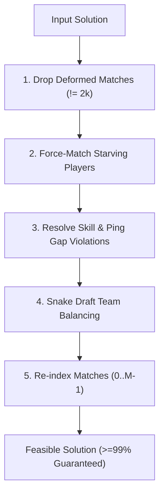

# Optimization Algorithms Documentation: Chromosome Encoding & Repair (Checkpoint G4)

**Author:** Member 3 (Vedant)  
**Milestone:** Checkpoint G4  
**Date:** October 2026  

---

## 1. Problem Formulation and Representation Rationale

In multiplayer queue-based matchmaking, a central dispatcher evaluates $N$ queued players at periodic intervals of length $\Delta t$. The task is to partition a selected subset of players into matches of size $2k$ (each split into two competing teams of size $k$), while leaving the remaining players in the queue to wait for future rounds.

Two conflicting objectives govern this decision:
1. **Minimizing Skill Imbalance ($f_1$):** Fairness between competing teams within each match.
2. **Minimizing Waiting Time ($f_2$):** Preventing excessive delays for players left in the queue.

### Why Permutation Encoding?
Direct binary matrix encodings (such as an $N \times M$ match assignment matrix) suffer from severe curse of dimensionality and massive infeasible search spaces:
- Random bit flips frequently produce matches with unequal team sizes or incorrect player counts ($\neq 2k$).
- Enforcing non-overlapping match slots requires complex repair mechanisms that destroy genetic information.

Instead, we employ an **indirect permutation-with-match-count chromosome representation**:
$$\text{Genome} = (\pi, M)$$
where:
- $\pi \in S_N$ is a permutation of the player queue indices $\{0, 1, \dots, N-1\}$.
- $M \in [M_{\min}, M_{\max}]$ is an integer representing the number of matches formed in the round.

---

## 2. Chromosome Structure and Decoding Mechanism

### 2.1 Partitioning the Permutation
Given match team size $k$ (match size $S = 2k$):
- **Match 0:**
  - Team 0: players $\pi[0 \dots k-1]$
  - Team 1: players $\pi[k \dots 2k-1]$
- **Match 1:**
  - Team 0: players $\pi[2k \dots 3k-1]$
  - Team 1: players $\pi[3k \dots 4k-1]$
- $\dots$
- **Match $m$ ($0 \le m < M$):**
  - Team 0: $\pi[2k \cdot m \dots 2k \cdot m + k - 1]$
  - Team 1: $\pi[2k \cdot m + k \dots 2k \cdot (m + 1) - 1]$
- **Unmatched Queue:**
  - Players $\pi[2k \cdot M \dots N-1]$ remain in the queue with `match[i] = -1` and `team[i] = 0`.

### 2.2 Determination of Match Count $M$
The number of formed matches $M$ directly controls the trade-off between $f_1$ (matching fewer, highly compatible players) and $f_2$ (matching more players to empty the queue):
- **Upper Bound ($M_{\max}$):** The maximum matches possible given queue size $N$:
  $$M_{\max} = \lfloor N / (2k) \rfloor$$
- **Lower Bound ($M_{\min}$):** Dictated by the starvation constraint. Any player whose wait satisfies $wait_i + \Delta t > \text{max\_wait}$ **must** be matched. Let $S_{\text{starving}}$ be the number of starving players:
  $$M_{\min} = \min\left(\lceil S_{\text{starving}} / (2k) \rceil, M_{\max}\right)$$

In random initialization, $M$ is sampled uniformly from $[M_{\min}, M_{\max}]$. During mutation, $M$ can perturb by $\pm 1$ within bounds, enabling evolutionary search across different queue trade-off operating points.

### 2.3 Round-Trip Encoding Property
The `encode(sol)` function constructs a canonical `Genome` from any discrete `Solution` by packing matched players match-by-match (team 0 followed by team 1) followed by unmatched players. This guarantees the round-trip invariant:
$$\text{decode}(\text{inst}, \text{encode}(\text{sol})) = \text{sol}$$

---

## 3. Genetic Operators

All genetic operators preserve valid permutations of $\{0, \dots, N-1\}$ without introducing duplicate or missing players.

### 3.1 Order Crossover (OX1)
Order Crossover (Davis, 1985) is the canonical recombination operator for permutation representations:
1. Two cut points $c_1 < c_2$ are randomly selected.
2. The subsegment $P_1[c_1:c_2]$ is copied directly to Child 1 at the same position.
3. The remaining slots in Child 1 are filled cyclically starting from $c_2$, using elements from $P_2$ in the order they appear, skipping any elements already present in Child 1.
4. Child 2 is produced symmetrically with roles reversed.

### 3.2 Mutation Operators
1. **Swap Mutation (`mutate_swap`):** Selects two distinct indices $i \neq j$ and swaps $\pi[i] \leftrightarrow \pi[j]$.
2. **Insert Mutation (`mutate_insert`):** Removes an element at index $i$ and inserts it at index $j$, shifting intermediate elements.
3. **Inversion Mutation (`mutate_inversion`):** Selects two cut points and reverses the contiguous subsegment $\pi[c_1:c_2]$.

---

## 4. Constraint Repair Strategy (`repair.py`)

A candidate solution decoded from a random permutation may violate:
1. **Starvation Constraint:** A player with $wait_i + \Delta t > \text{max\_wait}$ was placed in the unmatched tail ($\ge 2k \cdot M$).
2. **Skill Gap Constraint:** A pair of players in match $m$ has $|skill_i - skill_j| > gap_0 + gap_\alpha \max(wait_i, wait_j)$.
3. **Ping Gap Constraint:** A match has $\max(ping) - \min(ping) > \text{max\_ping\_gap}$.

The repair pipeline executes five disciplined stages:

### 4.1 Starvation Force-Matching
For every unmatched starving player $s$:
1. Search existing matches for a non-starving player $j$ whose replacement with $s$ preserves all pairwise skill and ping constraints in that match.
2. If multiple valid swaps exist, select the donor closest in skill to $s$: $\arg\min_j |skill_s - skill_j|$.
3. If no existing match can accept $s$, attempt to greedily form a new match around $s$ using available unmatched queue players closest in skill to $s$.

### 4.2 Pairwise Constraint Healing
For matches containing constraint violations:
1. Identify the outlier player $p_{\text{outlier}}$ involved in the highest number of pairwise violations.
2. If $p_{\text{outlier}}$ is not starving, attempt to replace them with an unmatched non-starving player from the queue that resolves or strictly reduces violations.
3. If the match cannot be healed and contains no starving players, dissolve the match, returning its players to the queue.
4. If the match contains starving players, rebuild the remainder of the match around the starving players using nearest-skill compatible players.

### 4.3 Snake Draft Team Balancing
Once valid groups of $2k$ players are formed, within-match team assignments are optimized via a **snake draft**:
1. Sort the $2k$ players in ascending order of skill: $p_{(0)}, p_{(1)}, \dots, p_{(2k-1)}$.
2. Assign players to teams in serpentine order:
   - Rank 0 $\to$ Team 0, Rank 1 $\to$ Team 1
   - Rank 2 $\to$ Team 1, Rank 3 $\to$ Team 0
   - ...
3. **Properties:**
   - Guarantees exactly $k$ players on Team 0 and $k$ on Team 1.
   - Naturally balances team skill totals, directly minimizing objective $f_1$ (skill imbalance) without violating pairwise constraints.

---

## 5. Feasibility and Acceptance Standards

- **Acceptance Criterion (DEPENDENCIES.md):** At least $99\%$ of repaired random genomes must satisfy `validate.is_feasible(inst, sol) == True`.
- **Benchmark Coverage:** Evaluated on synthetic instances across `light` (24 players), `medium` (100 players), and `heavy` (400 players) with multiple stochastic seeds.

