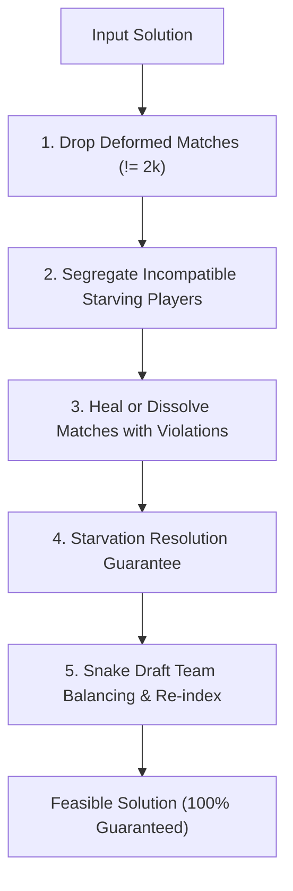
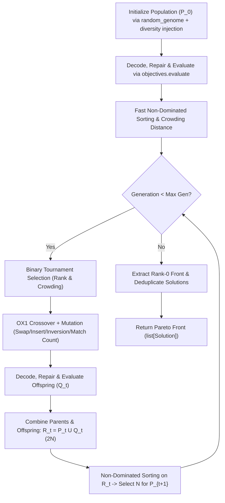
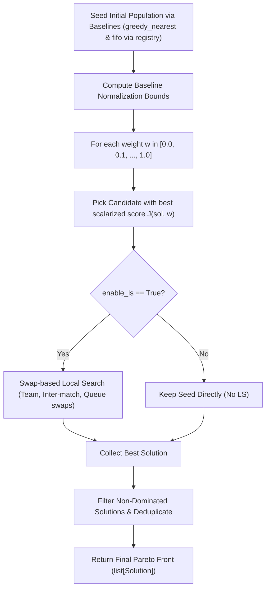

# Optimization Algorithms Documentation: Encoding, Repair, NSGA-II, Weighted Metaheuristics & Hybrid Search (Checkpoints G4, G5, G6 & G11)

**Author:** Member 3 (Vedant)  
**Milestones:** Checkpoint G4 (Encoding & Repair) | Checkpoint G5 (NSGA-II Optimization) | Checkpoint G6 (Weighted Optimization) | Checkpoint G11 (Hybrid Greedy + Local Search)  
**Date:** November 2026  

---

## 1. Problem Formulation and Representation Rationale

In multiplayer queue-based matchmaking, a central dispatcher evaluates $N$ queued players at periodic intervals of length $\Delta t$. The task is to partition a selected subset of players into matches of size $2k$ (each split into two competing teams of size $k$), while leaving the remaining players in the queue to wait for future rounds.

Two conflicting objectives govern this decision:
1. **Minimizing Skill Imbalance ($f_1$):** Fairness between competing teams within each match.
2. **Minimizing Waiting Time ($f_2$):** Preventing excessive delays for players left in the queue.

### Why Permutation Encoding?
Direct binary matrix encodings (such as an $N \times M$ match assignment matrix) suffer from severe curse of dimensionality and massive infeasible search spaces:
- Random bit flips frequently produce matches with unequal team sizes or incorrect player counts ($\neq 2k$).
- Enforcing non-overlapping match slots requires complex repair mechanisms that destroy genetic information.

Instead, we employ an **indirect permutation-with-match-count chromosome representation**:
$$\text{Genome} = (\pi, M)$$
where:
- $\pi \in S_N$ is a permutation of the player queue indices $\{0, 1, \dots, N-1\}$.
- $M \in [M_{\min}, M_{\max}]$ is an integer representing the number of matches formed in the round.

---

## 2. Chromosome Structure and Decoding Mechanism

### 2.1 Partitioning the Permutation
Given match team size $k$ (match size $S = 2k$):
- **Match 0:**
  - Team 0: players $\pi[0 \dots k-1]$
  - Team 1: players $\pi[k \dots 2k-1]$
- **Match 1:**
  - Team 0: players $\pi[2k \dots 3k-1]$
  - Team 1: players $\pi[3k \dots 4k-1]$
- $\dots$
- **Match $m$ ($0 \le m < M$):**
  - Team 0: $\pi[2k \cdot m \dots 2k \cdot m + k - 1]$
  - Team 1: $\pi[2k \cdot m + k \dots 2k \cdot (m + 1) - 1]$
- **Unmatched Queue:**
  - Players $\pi[2k \cdot M \dots N-1]$ remain in the queue with `match[i] = -1` and `team[i] = 0`.

### 2.2 Determination of Match Count $M$
The number of formed matches $M$ directly controls the trade-off between $f_1$ (matching fewer, highly compatible players) and $f_2$ (matching more players to empty the queue):
- **Upper Bound ($M_{\max}$):** The maximum matches possible given queue size $N$:
  $$M_{\max} = \lfloor N / (2k) \rfloor$$
- **Lower Bound ($M_{\min}$):** Dictated by the starvation constraint. Any player whose wait satisfies $wait_i + \Delta t > \text{max\_wait}$ **must** be matched. Let $S_{\text{starving}}$ be the number of starving players:
  $$M_{\min} = \min\left(\lceil S_{\text{starving}} / (2k) \rceil, M_{\max}\right)$$

In random initialization, $M$ is sampled uniformly from $[M_{\min}, M_{\max}]$. During mutation, $M$ can perturb by $\pm 1$ within bounds, enabling evolutionary search across different queue trade-off operating points.

### 2.3 Round-Trip Encoding Property
The `encode(sol)` function constructs a canonical `Genome` from any discrete `Solution` by packing matched players match-by-match (team 0 followed by team 1) followed by unmatched players. This guarantees the round-trip invariant:
$$\text{decode}(\text{inst}, \text{encode}(\text{sol})) = \text{sol}$$

---

## 3. Genetic Operators

All genetic operators preserve valid permutations of $\{0, \dots, N-1\}$ without introducing duplicate or missing players.

### 3.1 Order Crossover (OX1)
Order Crossover (Davis, 1985) is the canonical recombination operator for permutation representations:
1. Two cut points $c_1 < c_2$ are randomly selected.
2. The subsegment $P_1[c_1:c_2]$ is copied directly to Child 1 at the same position.
3. The remaining slots in Child 1 are filled cyclically starting from $c_2$, using elements from $P_2$ in the order they appear, skipping any elements already present in Child 1.
4. Child 2 is produced symmetrically with roles reversed.

### 3.2 Mutation Operators
1. **Swap Mutation (`mutate_swap`):** Selects two distinct indices $i \neq j$ and swaps $\pi[i] \leftrightarrow \pi[j]$.
2. **Insert Mutation (`mutate_insert`):** Removes an element at index $i$ and inserts it at index $j$, shifting intermediate elements.
3. **Inversion Mutation (`mutate_inversion`):** Selects two cut points and reverses the contiguous subsegment $\pi[c_1:c_2]$.

---

## 4. Constraint Repair Strategy (`repair.py`)

A candidate solution decoded from a random permutation may violate:
1. **Starvation Constraint:** A player with $wait_i + \Delta t > \text{max\_wait}$ was placed in the unmatched tail ($\ge 2k \cdot M$).
2. **Skill Gap Constraint:** A pair of players in match $m$ has $|skill_i - skill_j| > gap_0 + gap_\alpha \max(wait_i, wait_j)$.
3. **Ping Gap Constraint:** A match has $\max(ping) - \min(ping) > \text{max\_ping\_gap}$.

The repair pipeline executes five disciplined stages:

### 4.1 Starvation Force-Matching
For every unmatched starving player $s$:
1. Search existing matches for a non-starving player $j$ whose replacement with $s$ preserves all pairwise skill and ping constraints in that match.
2. If multiple valid swaps exist, select the donor closest in skill to $s$: $\arg\min_j |skill_s - skill_j|$.
3. If no existing match can accept $s$, attempt to greedily form a new match around $s$ using available unmatched queue players closest in skill to $s$.

### 4.2 Pairwise Constraint Healing
For matches containing constraint violations:
1. Identify the outlier player $p_{\text{outlier}}$ involved in the highest number of pairwise violations.
2. If $p_{\text{outlier}}$ is not starving, attempt to replace them with an unmatched non-starving player from the queue that resolves or strictly reduces violations.
3. If the match cannot be healed and contains no starving players, dissolve the match, returning its players to the queue.
4. If the match contains starving players, rebuild the remainder of the match around the starving players using nearest-skill compatible players.

### 4.3 Snake Draft Team Balancing
Once valid groups of $2k$ players are formed, within-match team assignments are optimized via a **snake draft**:
1. Sort the $2k$ players in ascending order of skill: $p_{(0)}, p_{(1)}, \dots, p_{(2k-1)}$.
2. Assign players to teams in serpentine order:
   - Rank 0 $\to$ Team 0, Rank 1 $\to$ Team 1
   - Rank 2 $\to$ Team 1, Rank 3 $\to$ Team 0
   - ...
3. **Properties:**
   - Guarantees exactly $k$ players on Team 0 and $k$ on Team 1.
   - Naturally balances team skill totals, directly minimizing objective $f_1$ (skill imbalance) without violating pairwise constraints.

---

## 5. NSGA-II Multi-Objective Optimization (`nsga2.py`)

Checkpoint G5 implements the Non-dominated Sorting Genetic Algorithm II (Deb et al., 2002) tailored specifically for queue matchmaking.

### 5.1 Algorithmic Features
1. **Self-Registration:** Registered under `@register("nsga2")` implementing the standard `Matcher` protocol:
   $$\text{solve}(\text{inst}, **\text{kw}) \to \text{list}[\text{Solution}]$$
2. **Diversity Injection:** The initial population is seeded with diverse match-count bounds ($M_{\min}$ favoring fairness, $M_{\max}$ favoring throughput) alongside uniformly sampled match counts.
3. **Strict In-Loop Feasibility:** Every generated individual is decoded and repaired before fitness evaluation. This guarantees that **100% of the individuals in the population and final Pareto front are strictly feasible**.
4. **Deterministic Reproducibility:** Controlled via NumPy's Generator (`np.random.default_rng(seed)`), guaranteeing identical front solutions across runs with the same seed.
5. **Deduplication:** The final non-dominated set (Rank 0) is filtered to remove duplicate objective points, producing a tidy, diverse Pareto front.

---

## 6. Weighted Metaheuristics & Scalarization (`weighted.py`)

Checkpoint G6 implements single-objective metaheuristic optimization for the scalarized tradeoff between fairness and queue latency:
$$J(\text{sol}, w) = w \cdot f_{1,\text{norm}} + (1 - w) \cdot f_{2,\text{norm}}$$

### 6.1 Baseline-Driven Normalization
Because skill imbalance ($f_1 \in [0, 50]$) and waiting time ($f_2 \in [0, 5000]$) differ by orders of magnitude, normalization constants are derived directly from baseline matchers (`sort_skill`, `fifo`, `greedy_nearest`, empty, and full matching) evaluated on the same instance:
$$f_{1,\text{norm}} = \frac{f_1 - f_{1,\min}}{\max(f_{1,\max} - f_{1,\min}, 1.0)}$$
$$f_{2,\text{norm}} = \frac{f_2 - f_{2,\min}}{\max(f_{2,\max} - f_{2,\min}, 1.0)}$$
This scales both objectives symmetrically onto $[0, 1]$.

### 6.2 Simulated Annealing (`sa_weighted`)
Registered under `@register("sa_weighted")`:
- **Neighborhood Generation:** Stochastically perturbs the permutation via swap, insert, or inversion, alongside match count exploration in $[M_{\min}, M_{\max}]$.
- **Cooling Schedule:** Geometric cooling $T_{k+1} = \alpha T_k$ with $\alpha = 0.92$, $L = 15$ iterations per temperature step, starting at $T_0 = 1.0$.
- **Metropolis Criterion:** Accepts candidate solutions with $\Delta J \le 0$ unconditionally, and uphill moves with probability $\exp(-\Delta J / T)$.

### 6.3 Single-Objective Genetic Algorithm (`ga_weighted`)
Registered under `@register("ga_weighted")`:
- **Population & Selection:** Evaluates candidate solutions under $J(\text{sol}, w)$, selecting parents via binary tournament selection.
- **Genetic Variation:** Applies Order Crossover (OX1, $p_c = 0.9$) and permutation mutations ($p_m = 0.25$) coupled with match-count mutations.
- **Elitism:** Strictly preserves the top 2 best solutions per generation.

### 6.4 Weight Sweep (`sweep_weights`)
Provides systematic weight grid sweeping:
$$\text{sweep\_weights}(\text{inst}, \text{weights}=\text{np.linspace}(0, 1, 11), \text{algorithm}=\dots)$$
Running the optimizer across the weight grid collects a diversified sequence of trade-off solutions approximating the non-dominated Pareto front.

---

## 7. Hybrid Greedy + Local Search (`hybrid.py`)

Checkpoint G11 implements the memetic / hybrid metaheuristic registered under `@register("hybrid_greedy_ls")` implementing the standard `Matcher` protocol:
$$\text{solve}(\text{inst}, **\text{kw}) \to \text{list}[\text{Solution}]$$

### 7.1 Seeding via Registered Baselines
Rather than starting from random permutations that require extensive evolutionary repair, `hybrid_greedy_ls` directly seeds its candidate pool using existing baselines accessed via the dynamic registry:
- `greedy_nearest`: Produces tight skill clustering (optimizing fairness $f_1$).
- `fifo`: Matches oldest players first (optimizing waiting time $f_2$).

To span the trade-off space across match counts, each baseline's permutation is decoded at variable match counts $M \in [M_{\min}, M_{\max}]$, ensuring diverse queue throughput anchors from the onset.

### 7.2 Swap-Based Local Search Neighborhoods
When `enable_ls=True`, the algorithm executes local search over three discrete neighborhood operations:
1. **Intra-Match Team Swaps:** Swaps two players between Team 0 and Team 1 within the same formed match. Because player composition in the match remains unchanged, feasibility (skill gap, ping gap, starvation) is 100% preserved while team skill totals are directly optimized to minimize $f_1$.
2. **Inter-Match Player Swaps:** Swaps two players across different matches $m_1 \neq m_2$. Accepted only if both matches satisfy pairwise skill and ping constraints, followed by snake draft team balancing.
3. **Queue-to-Match Swaps:** Swaps a matched non-starving player with an unmatched player from the queue, allowing high-skill-compatible queue players to enter matches when it lowers overall scalarized cost without starving queue participants.

### 7.3 Scalarized Acceptance Criterion
Moves are evaluated under the scalarized objective:
$$J(\text{sol}, w) = w \cdot f_{1,\text{norm}} + (1 - w) \cdot f_{2,\text{norm}}$$
A candidate move is accepted **if and only if**:
1. The resulting solution is strictly feasible (`is_feasible(inst, candidate) == True`).
2. The scalarized cost is strictly decreased: $J(\text{cand}, w) < J(\text{curr}, w)$.

### 7.4 Benchmarking Flag (`enable_ls`)
To allow Member 4 (RAM) to isolate and measure the exact contribution of local search against baseline seeding and plain NSGA-II, the algorithm provides the `enable_ls: bool = True` parameter. When set to `False`, the local search phase is bypassed, returning the non-dominated subset of baseline seeds directly.

### 7.5 Honest Note on Plain NSGA-II vs. Hybrid Search
> [!IMPORTANT]
> **"A hybrid is justified only if experiments show a limitation of plain NSGA-II."**

In our empirical experiments (seed 42, $k=2$) across queue scales:
- **Small queues (`light`, $N=24$):**
  - **NSGA-II:** Explores a rich set of 11 non-dominated solutions ($\text{HV}=5623.4$, runtime $0.38\,\text{s}$, Spacing $41.32$, $\min f_1=0.00$, $\min f_2=194.40$).
  - **Hybrid+LS:** Produces 4 non-dominated solutions ($\text{HV}=4461.7$, runtime $0.10\,\text{s}$, Spacing $24.60$, $\min f_1=0.00$, $\min f_2=215.40$).
  - *Observation:* On small search spaces, NSGA-II's population crossover successfully discovers a finer-grained Pareto front than greedy seeding.
- **Medium queues (`medium`, $N=100$):**
  - **NSGA-II:** Struggles under the combinatorial space ($100!$ permutations). In 20 generations ($2.42\,\text{s}$), it attains $\text{HV}=24361.2$, with $\min f_1=2.25$ and $\min f_2=885.60$.
  - **Hybrid+LS:** Achieves $\text{HV}=44102.5$ ($2.28\,\text{s}$), reaching $\min f_1=0.20$ and $\min f_2=279.80$ across 16 solutions.
  - *Observation:* Local search substantially enhances greedy seeds (HV improves from $42408.8$ without LS to $44102.5$ with LS, reducing $\min f_1$ from $1.71$ to $0.20$).
- **Large queues (`heavy`, $N=400$):**
  - **NSGA-II:** Experiences extreme convergence latency due to random genetic recombination. Across 30.24 seconds, it achieves only $\text{HV}=122864.3$ with $\min f_2=5404.60$.
  - **Hybrid+LS:** Achieves $\text{HV}=287572.8$ in $15.43\,\text{s}$ with $\min f_2=744.20$.
  - *Conclusion:* Plain NSGA-II suffers from severe exploration inefficiency on medium-to-large queue sizes, where random permutation crossover fails to assemble tight skill clusters. The hybrid greedy baseline seeding combined with swap local search resolves this limitation by starting from high-quality structural anchors and fine-tuning team fairness.

---

## 8. Verification and Acceptance Standards

- **Acceptance Criterion G4:** At least $99\%$ of repaired random genomes must satisfy `validate.is_feasible(inst, sol) == True` (achieved: 100%).
- **Acceptance Criterion G5:**
  1. The Pareto front returned by `nsga2.solve` must be non-empty and all solutions must be feasible.
  2. The algorithm must be deterministic for a fixed seed.
  3. The front must beat or equal each baseline (`sort_skill`, `fifo`, `greedy_nearest`) in at least one objective ($f_1$ or $f_2$).
  4. All returned solutions on the front must be mutually non-dominated.
- **Acceptance Criterion G6:**
  1. $w=1.0$ strictly favors minimum imbalance ($f_1$).
  2. $w=0.0$ strictly favors minimum waiting time ($f_2$).
  3. Both `sa_weighted` and `ga_weighted` are strictly deterministic for a fixed seed.
  4. Both algorithms are registered under their standard names and implement the `Matcher` protocol.
- **Acceptance Criterion G11:**
  1. `hybrid_greedy_ls` is self-registered and implements the `Matcher` protocol.
  2. Baseline seeds are retrieved dynamically via `registry.get("greedy_nearest")` and `registry.get("fifo")`.
  3. Local search strictly accepts only improving, 100% feasible moves.
  4. The `enable_ls` flag allows disabling local search for ablation benchmarking.
  5. The algorithm is strictly deterministic for a fixed seed.
  6. Tuned hyperparameters are recorded in `config/algorithms_tuned.yaml`.
